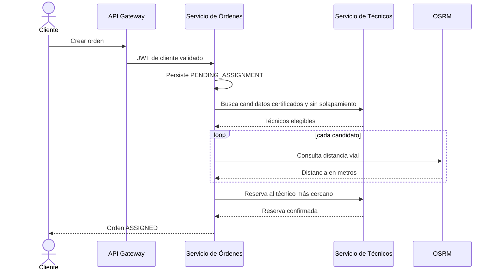

# Compromiso de alcance del TPI

## Problema

Una empresa de mantenimiento domiciliario necesita asignar solicitudes de electricidad, plomería, gas y aire acondicionado a técnicos que posean la especialidad y certificación correspondiente. La asignación debe considerar disponibilidad y cercanía vial al domicilio del cliente.

## Actores

| Actor | Necesidad | Operaciones autorizadas |
| --- | --- | --- |
| Cliente | Solicitar y seguir una reparación | Crear, listar, consultar y cancelar sus propias órdenes. |
| Despachador | Mantener la capacidad operativa y resolver excepciones | Crear y desactivar técnicos, consultar candidatos y reintentar asignaciones. |
| Técnico | Registrar la atención de visitas que le corresponden | Iniciar y completar exclusivamente sus órdenes asignadas. |
| Administrador | Operar el sistema | Incluye las facultades del despachador. |

## Proceso central

Si no hay candidato, OSRM no responde o falla la reserva, la orden queda `ASSIGNMENT_FAILED` con una explicación. El despachador puede reintentar cuando la condición haya cambiado.

## Reglas de negocio comprometidas

1. Un técnico debe estar activo y tener una certificación vigente para la fecha solicitada.
2. La especialidad solicitada debe pertenecer al técnico.
3. No puede haber dos reservas superpuestas para un técnico ni dos reservas activas para la misma orden.
4. Entre los candidatos elegibles se asigna el de menor distancia vial devuelta por OSRM.
5. La orden sólo puede pasar de `ASSIGNED` a `IN_PROGRESS` y de allí a `COMPLETED`.
6. Sólo el técnico asignado realiza esas transiciones; sólo el cliente dueño o un usuario privilegiado puede cancelar.

## Responsabilidades y límites

`technician-service` es dueño de técnicos, certificaciones, agenda y reservas. `work-order-service` es dueño de las órdenes y sus estados. La comunicación se realiza por REST usando una cuenta de servicio emitida por Keycloak; no se comparten entidades ni tablas. Esta división permite modificar la gestión de personal sin acoplarla al ciclo de vida de una reparación.

## Integración externa

OSRM recibe las coordenadas del técnico y del domicilio, y devuelve distancia vial. Ese valor define cuál candidato se reserva; por eso es una dependencia del proceso de negocio. Ante indisponibilidad o respuesta inválida, el sistema no asigna por distancia geodésica ni deja una reserva parcial: expone el resultado reintentable `ASSIGNMENT_FAILED`.

## Evidencia para la defensa

- Ejecutar el recorrido de [README](../README.md) con usuarios de Keycloak.
- Mostrar Swagger consolidado en el Gateway y las definiciones OpenAPI de cada microservicio.
- Ejecutar la colección Postman con token de cada rol.
- Intentar iniciar una orden con un técnico diferente para demostrar el `403`.
- Crear dos órdenes en la misma franja para el mismo único técnico y demostrar que la segunda no queda asignada.
- Dejar temporalmente una URL OSRM inválida, crear una orden y mostrar la recuperación mediante reintento.
