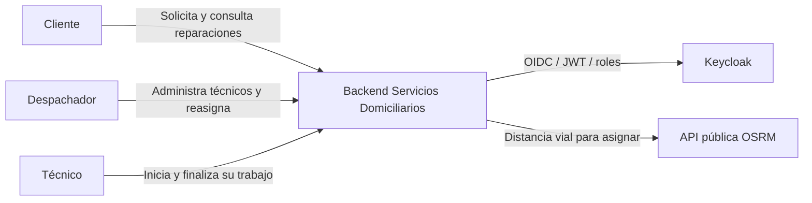

# C1 - Diagrama de contexto

El sistema asigna una orden al técnico elegible cuya ruta vial al domicilio es más corta. Keycloak es responsable de la identidad; OSRM proporciona un dato que el sistema no posee y que influye directamente en la asignación.
