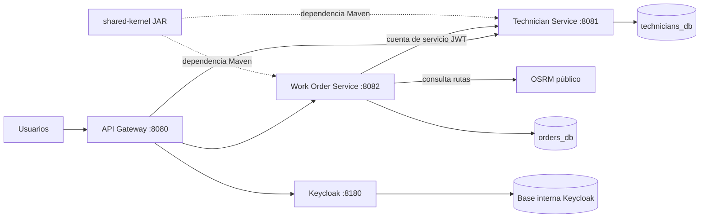

# C2 - Diagrama de contenedores

El Gateway es el único servicio de aplicación publicado. Cada microservicio persiste su información en una base independiente y valida el JWT nuevamente. El servicio de órdenes no accede a la base de técnicos: usa su API con una cuenta de servicio de Keycloak.
